# ⚡ 智冷优选 · Philips Shop

<div align="center">

**家电零售一体化经营系统 —— 商城选购 × 进销存 × 财务 × 扫码出入库，一套系统跑通全链路**

[](https://philips.duzehao.online/admin/)
[](#-小程序商城)
[](#-android-管理app)
[](#-线上体验)


**[🖥 线上体验](#-线上体验) · [🖼 界面预览](#-界面预览) · [✨ 核心能力](#-核心能力) · [🏗 架构](#-架构一览) · [🗺 路线图](#-路线图) · [❓ FAQ](docs/FAQ.md)**

> 📢 **本仓库是项目介绍页，只含截图与文档，不含源码。**
> 想合作、想看演示、想了解实现思路，直接看下文或联系作者。

</div>

---

## ✨ 为什么值得看

| | 亮点 | 一句话说明 |
|---|---|---|
| 🛒 | **消费者端完整闭环** | 浏览 → 对比 → 加购 → 下单 → 支付登记 → 退款/收货，全在小程序里完成 |
| 📦 | **一物一码逐台追踪** | 每台机器独立条码，已支付订单必须扫码绑定单品才能发货 |
| 📲 | **三端协同** | 小程序卖货 ＋ Web 管账 ＋ Android 扫码出入库，同一套数据 |
| 📊 | **老板看得懂的经营概况** | 今日成交、订单、库存预警、毛利、资金构成，一屏全览 |
| 🔐 | **角色分权＋全程留痕** | 老板 / 财务 / 仓库等角色分权，关键操作全部写审计日志 |
| 🚚 | **出库留证照片** | 发货/扫码出库可附 ≤9 张现场照片，售后有据可查 |

---

## 🖥 线上体验

| 入口 | 地址 | 说明 |
|---|---|---|
| 🖥 Web 管理后台 | https://philips.duzehao.online/admin/ | 商品 / 订单 / 库存 / 财务 / 报表 |
| 🔌 API 根 | https://philips.duzehao.online/api/v1/ | 统一版本前缀 |
| 💚 健康检查 | https://philips.duzehao.online/health | 服务状态探针 |
| 📲 Android 管理 App | 跟随 Web 版本自更新分发 | 版本检查 ＋ APK 自更新下载 |
| 🟢 微信小程序 | 体验版按需开放 | 联系作者获取体验码 |

> 目前为**线下收款**模式（后台“确认收款”登记），微信支付 V3 按商户资料就绪情况接入。

---

## 🖼 界面预览

### 1️⃣ Web 管理后台（桌面端）

<table>
<tr>
<td align="center"><b>📊 经营概况</b><br><sub>今日成交 / 订单 / 预警 / 毛利 / 资金</sub></td>
<td align="center"><b>📦 商品管理</b><br><sub>资料 / 分类 / 图片 / 条码 / 库存</sub></td>
</tr>
<tr>
<td>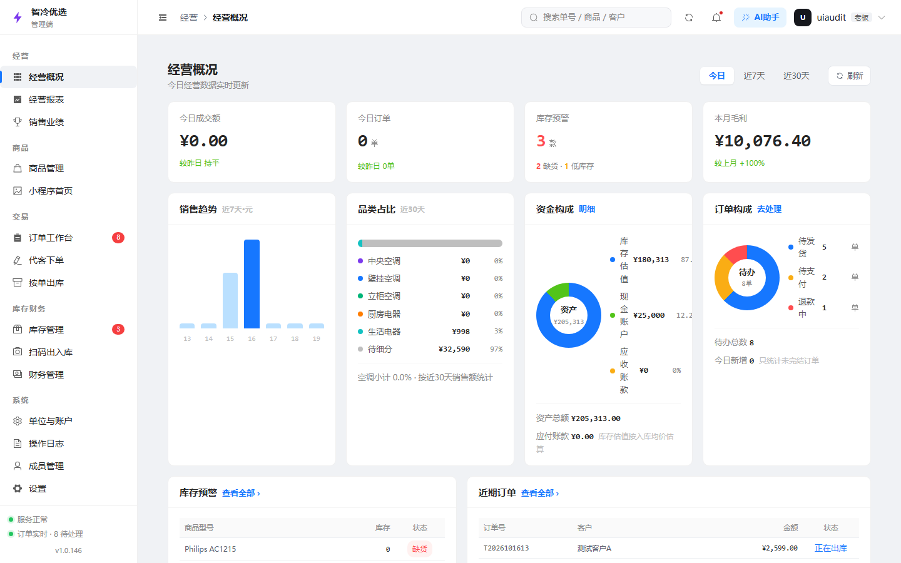</td>
<td>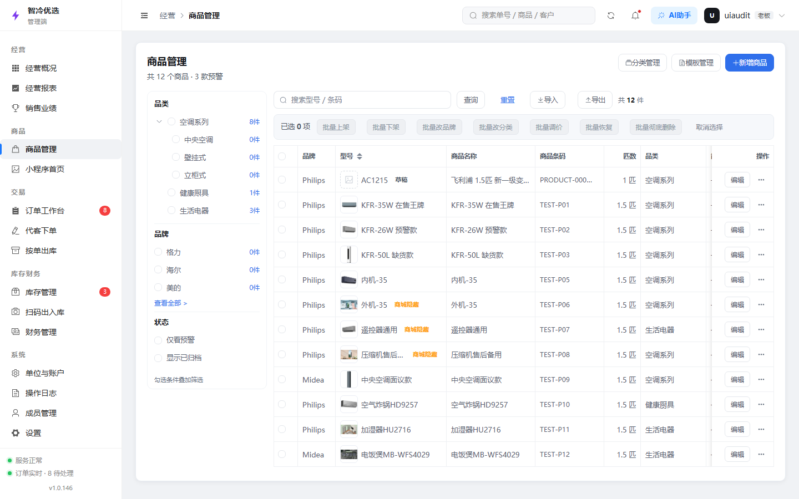</td>
</tr>
<tr>
<td align="center"><b>🧾 订单工作台</b><br><sub>7 态流转 / 调度 / 取消回补</sub></td>
<td align="center"><b>🏬 库存管理</b><br><sub>采购入库 / 销售出库 / 修正</sub></td>
</tr>
<tr>
<td>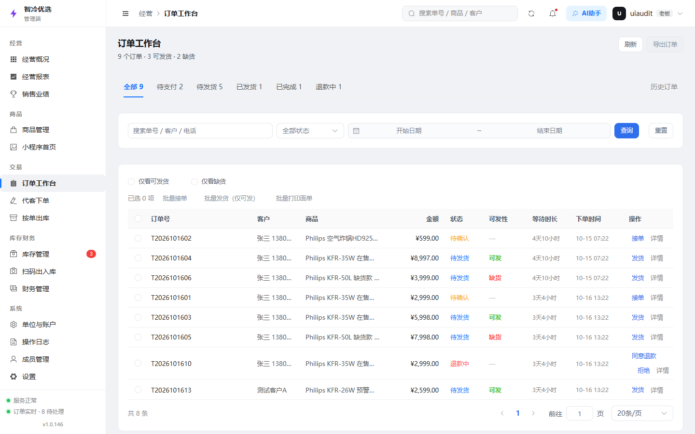</td>
<td>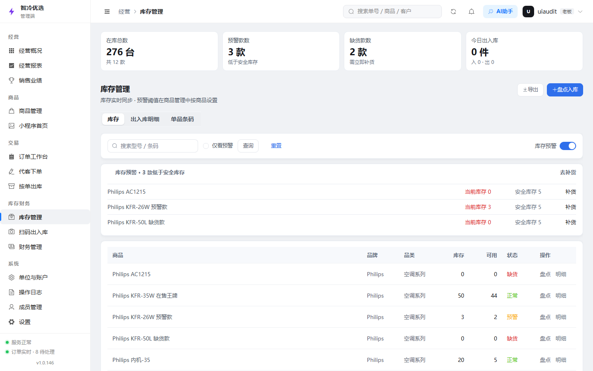</td>
</tr>
<tr>
<td align="center"><b>💰 记一笔</b><br><sub>收支 / 转账 / 流水一次记清</sub></td>
<td align="center"><b>🤝 单位与账户</b><br><sub>客户供应商往来 / 资金账户</sub></td>
</tr>
<tr>
<td>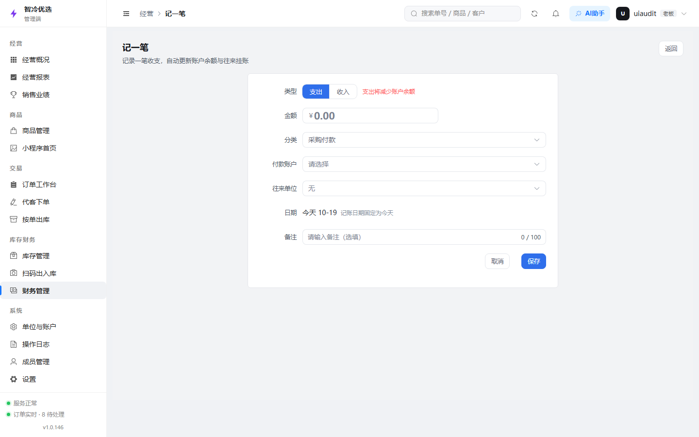</td>
<td>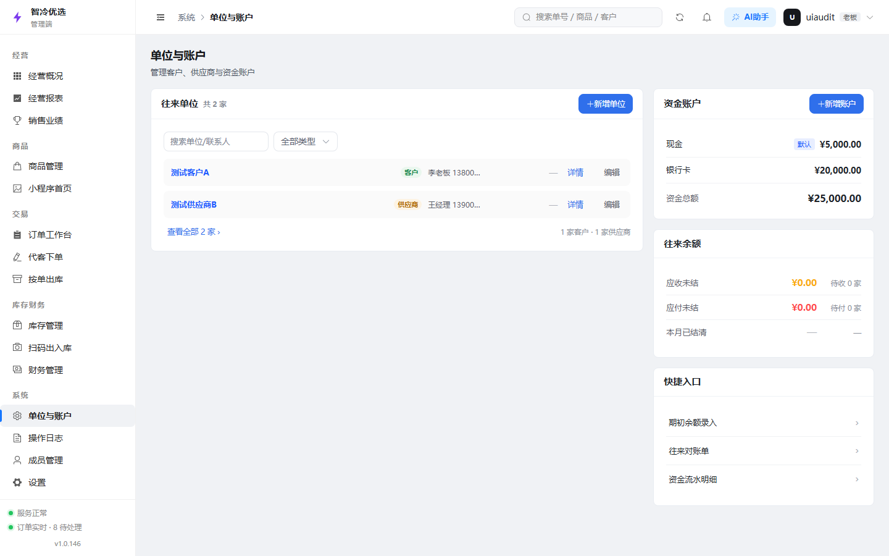</td>
</tr>
</table>

### 2️⃣ 小程序商城（消费者端）

<table>
<tr>
<td align="center"><b>🏠 首页</b></td>
<td align="center"><b>🗂 分类</b></td>
<td align="center"><b>🔍 商品详情</b></td>
</tr>
<tr>
<td>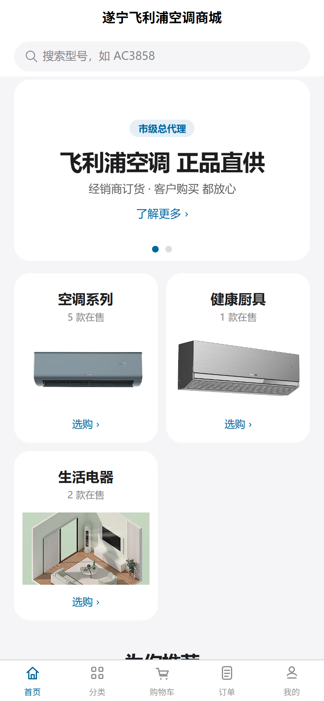</td>
<td>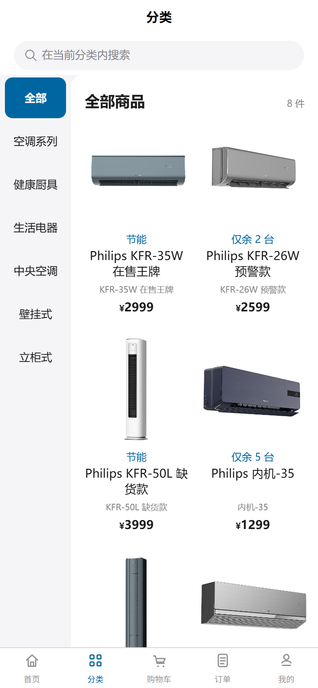</td>
<td>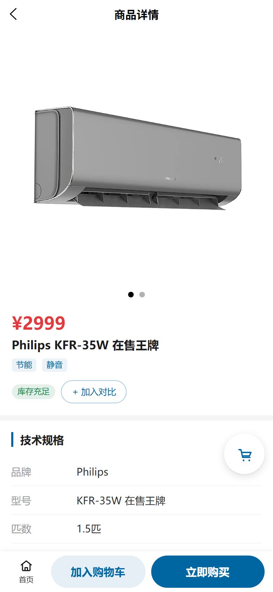</td>
</tr>
<tr>
<td align="center"><b>🛒 购物车</b></td>
<td align="center"><b>✅ 确认订单</b></td>
<td align="center"><b>🧾 我的订单</b></td>
</tr>
<tr>
<td>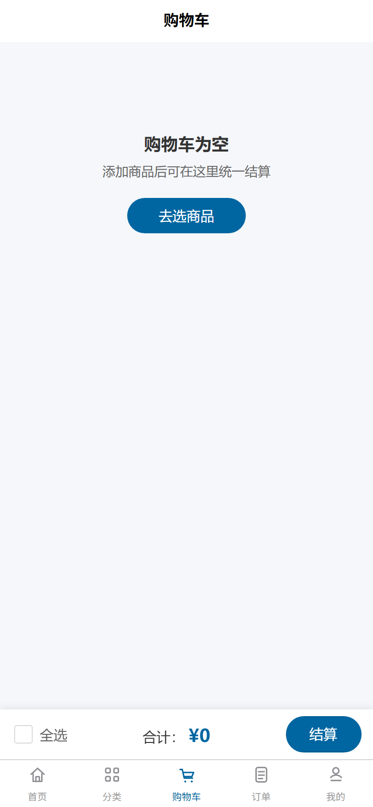</td>
<td>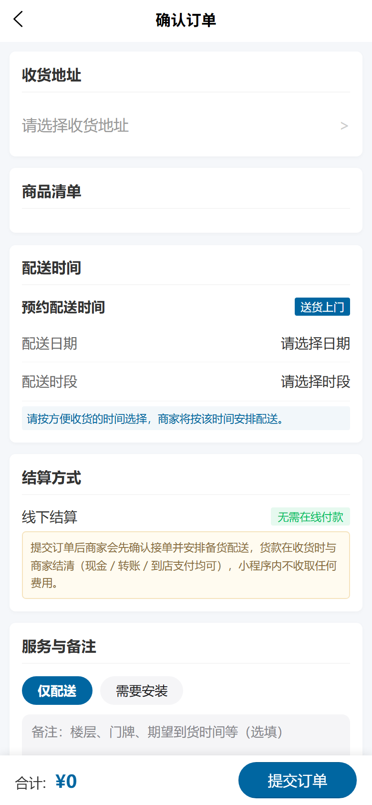</td>
<td>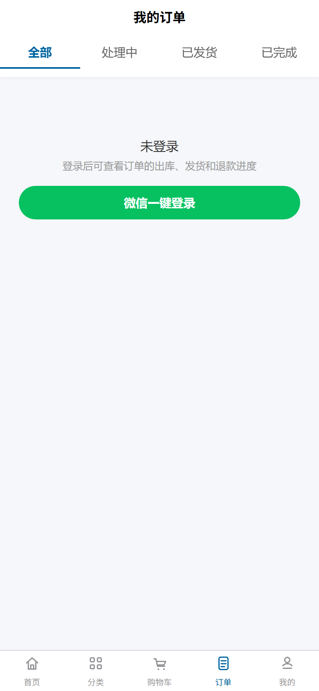</td>
</tr>
</table>

> 另有 **个人中心**（我的资产 / 地址 / 售后入口）：见 `assets/mp/mp-07-my.png`

<details>
<summary>📱 点开展示：个人中心截图</summary>

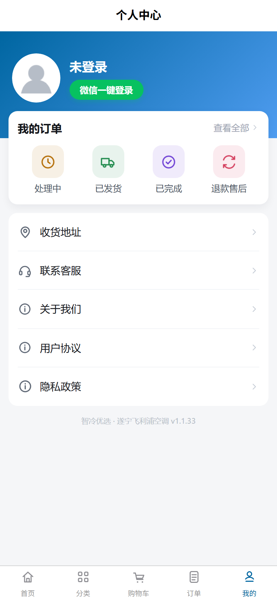

</details>

### 3️⃣ Android 管理 App（仓库 / 外勤）

<table>
<tr>
<td align="center"><b>🏠 首页</b></td>
<td align="center"><b>🧾 订单工作台</b></td>
<td align="center"><b>📷 扫码出入库</b></td>
</tr>
<tr>
<td>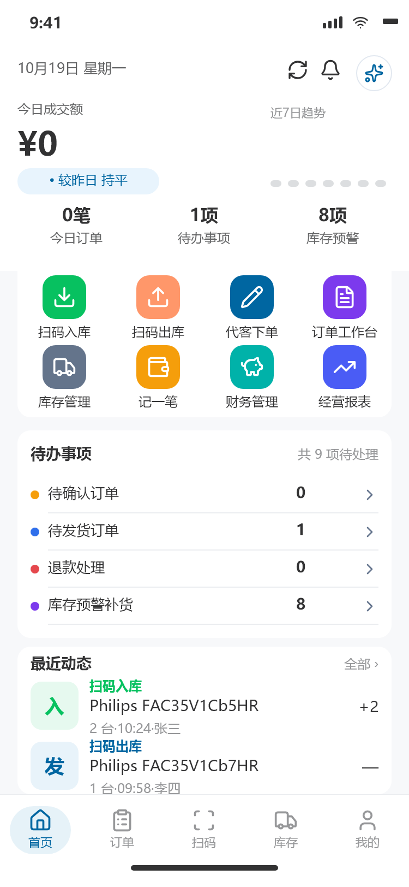</td>
<td>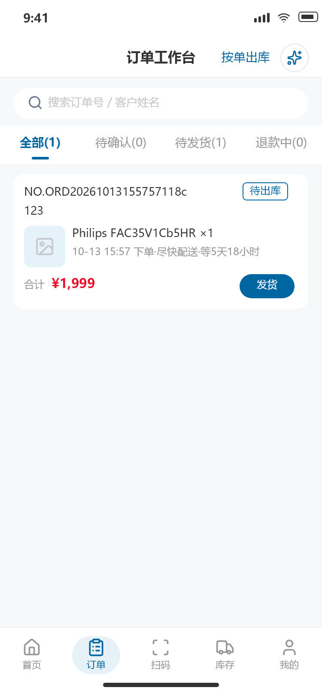</td>
<td>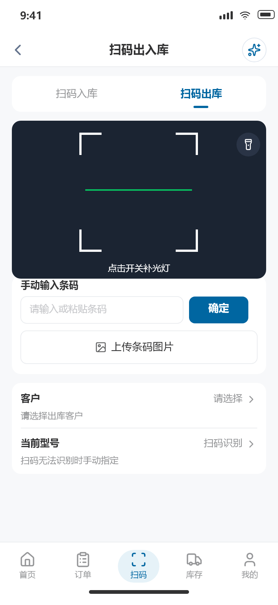</td>
</tr>
<tr>
<td align="center"><b>🏬 库存管理</b></td>
<td align="center"><b>👤 我的</b></td>
<td align="center"><b>📸 出库留证</b></td>
</tr>
<tr>
<td>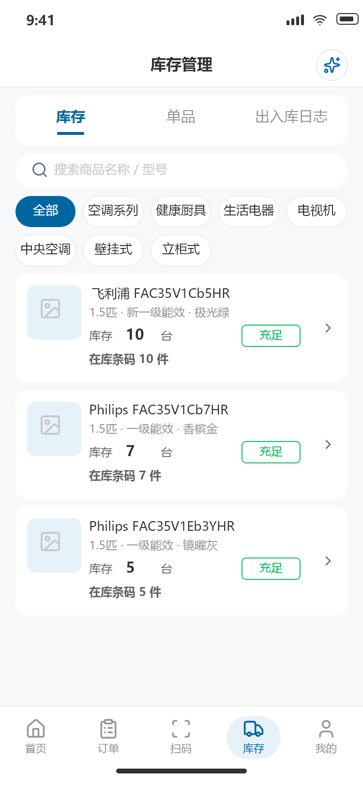</td>
<td>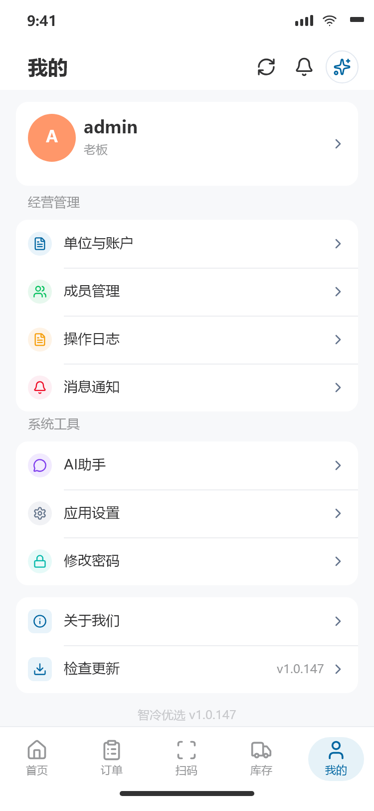</td>
<td>发货 / 扫码出库可附多张现场照片<br><sub>订单详情与库存记录均可回看</sub></td>
</tr>
</table>

---

## ✨ 核心能力

| 模块 | 能力一览 |
|---|---|
| 🛒 移动商城 | 分类浏览、商品详情、多商品参数对比（最多 3 款）、购物车、地址、下单、订单查询、退款申请、微信登录、下拉刷新 |
| 📦 商品管理 | 商品资料、分类、图片上传、库存、建议售价、商城排序、商品条码、单品条码 |
| 🏬 进销存 | 采购入库、销售出库、库存修正、出入库记录、结算与调价、订单调度、取消回补库存 |
| 🏷 一物一码 | 单品逐台建档追踪；已支付订单必须扫码绑定单品才能发货，杜绝错发 |
| 📷 扫码作业 | Android 摄像头扫码 ＋ 桌面 USB 扫码枪 ＋ 网页手工录入，统一抽象层 |
| 🧾 订单流转 | 7 态状态机：待支付 → 已支付 → 已发货 → 已完成 ／ 已取消 ／ 退款中 → 已退款，非法跳转直接拒绝 |
| 💰 财务管理 | 收支记账、账户转账、资金流水、往来单位余额联动，金额统一 Decimal 计算 |
| 📊 经营分析 | 今日订单、成交额、资金余额、库存预警、分类利润、销售业绩（本月 / 上月 / 近 3 月） |
| 👥 成员权限 | JWT 双 token、RBAC 角色分权、登录限速、token 版本失效 |
| 🧾 审计追踪 | 后台关键操作日志，可按对象与操作类型检索，全中文展示 |
| 🔄 App 分发 | 版本检查接口 ＋ APK 自更新下载，跟着 Web 版本走 |

---

## 🏗 架构一览

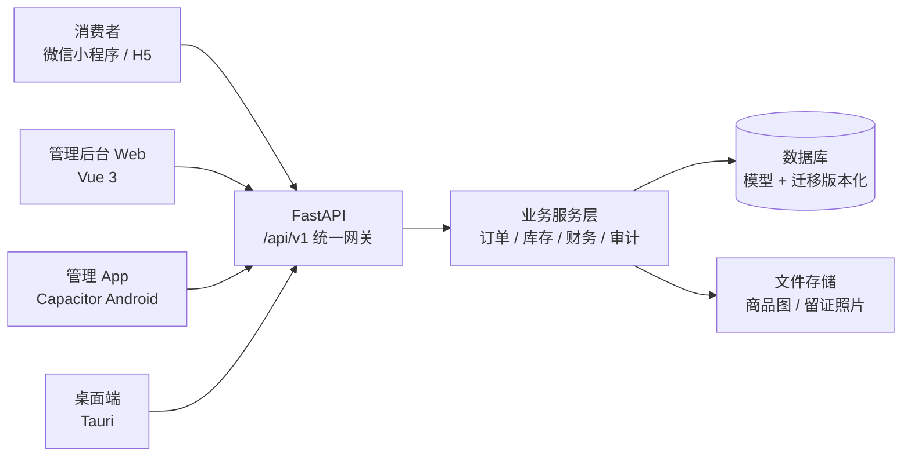

- **前端**：Vue 3 管理后台 ＋ UniApp 商城（小程序 / H5）＋ Capacitor Android 壳
- **后端**：FastAPI 分层（路由 → 服务 → 数据），`/api/v1` 版本前缀，统一响应包与全局异常处理
- **数据**：ORM 模型 ＋ 版本化迁移，库存与资金变动同事务提交并写审计
- **部署**：Docker Compose 一键起停 ＋ 反向代理 ＋ 每日备份（数据库与上传文件保留 30 天）
- **质量门**：后端 pytest 全量用例 ＋ 前端冒烟用例，构建产物指纹校验后才发版

> 实现细节与代码结构见 [docs/ARCHITECTURE.md](docs/ARCHITECTURE.md)（概念版，不含源码）。

---

## 🗺 路线图

- [x] 三端成型：小程序商城 ＋ Web 后台 ＋ Android 管理 App
- [x] 一物一码逐台追踪 ＋ 扫码出入库 ＋ 出库留证照片
- [x] 订单 7 态状态机 ＋ 财务记账 ＋ 经营概况大屏
- [x] RBAC 分权 ＋ 全中文审计日志 ＋ 每日备份
- [ ] 微信支付 V3（JSAPI 下单 / 回调验签 / 超时关单，待商户资料）
- [ ] 小程序正式发布（正式 AppID、域名白名单、备案、提审）
- [ ] 条码标签批量生成与打印
- [ ] 列表接口全面分页 ＋ 监控告警（uptime-kuma）

---

## 📁 这个仓库里有什么

```
philips-shop-showcase/
├── README.md            ← 本页（项目介绍主页）
├── assets/
│   ├── web/             ← Web 后台截图 ×6
│   ├── mp/              ← 小程序截图 ×7
│   └── app/             ← Android App 截图 ×5
└── docs/
    ├── ARCHITECTURE.md  ← 架构概念说明（无源码）
    └── FAQ.md           ← 常见问题
```

**郑重声明**：本仓库不包含任何可运行源码（无后端代码、无前端工程、无小程序工程、无数据库文件、无密钥配置），仅用于项目展示与交流。

---

## 🤝 合作与联系

- 🏪 如果你是家电/零售同行，想看真实后台演示 → 欢迎联系作者约演示
- 🧑‍💻 如果你是开发者，想交流进销存 / 一物一码 / UniApp 三端同构 → 欢迎提 Issue
- ⭐ 觉得这个项目有意思，请点右上角 **Star** 支持一下！

<div align="center">

**智冷优选 · Philips Shop**
让商城、库存与经营管理保持在同一条数据链路上。

</div>
